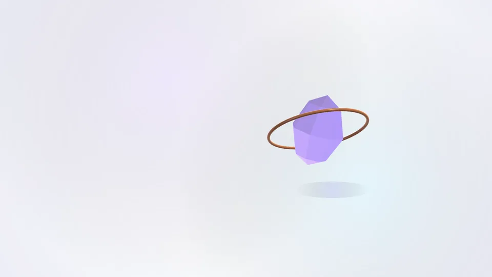
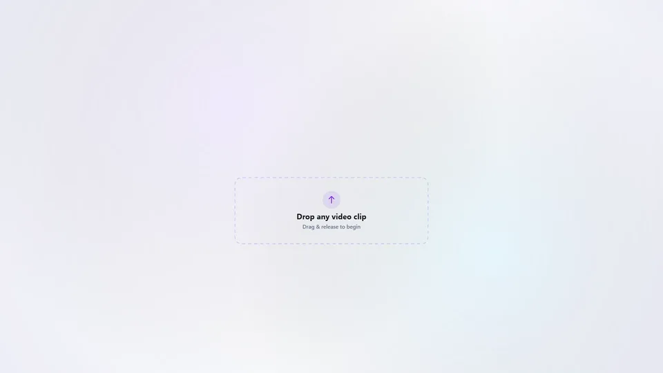

<p align="center">
  
</p>

<div align="center">

# `kinearc`

**Programmatic 4K motion graphics, WebGL2 3D, interactive web animation, and 1:1 CV video cloning engine for AI coding agents.**

<code>python install.py --agent all && python scripts/kinearc_cli.py doctor</code>

[Overview](#what-it-does) · [Showcase Examples](#built-in-showcase-examples) · [Install](#install) · [Quick Start](#quick-start) · [Architecture](#how-it-works) · [Docs](#documentation) · [FAQ](#faq) · [Roadmap](ROADMAP.md) · [Changelog](CHANGELOG.md)

[](LICENSE)
[](scripts/kinearc_cli.py)
[](engine/package.json)
[](references/kinearc-engine.md)
[](.github/workflows/ci.yml)

</div>

---

Every scene in `kinearc` is deterministic, time-driven code (`window.kinearc.seek(t)`) — zero AI video diffusion models, zero wall-clock `requestAnimationFrame` drift, and zero bundler lock-in for native HTML/Canvas/WebGL2 work. Whether you are **reverse-engineering a reference video (`MotionClone` 1:1 CV mode)** or **producing 4K 60fps 3D promos, explainers, and interactive web pages from scratch**, `kinearc v3.0` gives AI agents full-FPS computer vision extraction, a 60 FPS multi-mode inspection workbench (`scripts/kinearc_ui.py`), automated voiceover ducking, and a zero-dependency Node.js 24+ headless Chromium WebCodecs exporter (`engine/render.mjs`).

---

## What It Does

* **Zero-Dependency Native 4K WebCodecs Renderer (`engine/render.mjs`):** Automatically discovers Chrome/Edge/Chromium and encodes `<canvas>`/WebGL2 scenes in-page via `VideoEncoder` (AVC Annex-B Level 5.2 / VP9) piped directly to FFmpeg, with seamless CDP PNG fallback for pure DOM/SVG scenes and `--scale 2` scaling up to **3840×2160 @ 60fps**.
* **Full-FPS Computer Vision Cloning (`scripts/`):** Extracts 100% of reference frames (`extract_full_motion.py`), detects hard scene cuts (`scene_cuts.json` + `cuts/`), computes `source_loop_mae` seams, tracks dense Optical Flow & circular motion (`track_objects.py` -> `motionTracks.ts`), measures radii/colors (`measure_shapes_colors.py`), and ranks `worst_frames` MAE errors (`verify_motion_diff.py --check-loop`).
* **Interactive 60 FPS Dual Workbench UI (`scripts/kinearc_ui.py` + `scripts/ui/`):** Inspect live HTML scenes alongside MP4 renders in **6 viewport modes** (`Live`, `Clone`, `Side-by-Side`, `Split`, `Onion`, and `4× MAE Diff`) accelerated by an in-memory multi-phase `ImageBitmap` cache, optical `2×` Pixel Loupe, platform Safe Zones (`9:16`, `16:9`, `1:1`, `Thirds`), and real audio waveforms.
* **Frame, Area & Clip-Range Annotations + Right-Click Delete:** Click a point, drag a `Box`, mark a timeline clip range (`[ In` / `Out ]` or `Shift+Drag`), right-click any marker to delete it, or click **Copy AI Prompt** to hand structured `.kinearc_analysis/selection.json` notes + cropped snapshots directly back to your agent.
* **One-Click Live Render & Auto-Ducked Audio Finishing:** Trigger `/api/render` (`Render Still`, `Export 1080p 60fps`, `Export 4K 60fps`) right from the browser drawer, inspect live frame progress, hot-swap renders via `/api/render/load`, trim dead silences (`cut-pauses`), and auto-duck background music under voiceover + timestamped SFX (`audio_mix.py`).
* **Multi-Engine Creative Support:** Built-in guides route seamlessly across Native HTML/WebGL2 (`kinearc_cli.py`), **Remotion + `@remotion/three`**, **Motion Canvas**, **Manim**, **Blender Headless Python**, and **GSAP ScrollTrigger / WAAPI**.

---

## Built-In Showcase Examples

Clone the repository and preview or render both widescreen showcases directly ([examples/README.md](examples/README.md)):

<p align="center">
  
</p>

| Example Project | Specs | Highlights | Launch Command |
| :--- | :--- | :--- | :--- |
| **[`examples/kinearc-promo-3d/`](examples/kinearc-promo-3d/)** | `13.0s` · `5` scenes · `1920×1080` (`16:9`) & `1080×1920` (`9:16`) · `@ 60fps` | Zero-dep WebGL2 chamfered crystal prism & orbital ring, pearl editorial typing hook, 2×2 remix grid, dark 3D portal transition & 26-cue auto-synced SFX mix | `python scripts/kinearc_cli.py ui --project examples/kinearc-promo-3d/kinearc.project.json` |
| **[`examples/kinearc-tutorial/`](examples/kinearc-tutorial/)** | `18.0s` · `4` scenes · `1920×1080 @ 60fps` | Human-first 4-step walkthrough: drop any clip, extract pacing & sound feel, pick custom themes (`Pearl Violet` / `Midnight Gold` / `Warm Coral`), and compare split-wipe 4K export | `python scripts/kinearc_cli.py ui --project examples/kinearc-tutorial/kinearc.project.json` |

Render full-sound MP4s directly (widescreen 1080p/4K for GitHub/web or `9:16` vertical for social):

```bash
# Widescreen Promo & Tutorial (1920x1080 @ 60fps + 48kHz stereo SFX mix)
python scripts/kinearc_cli.py render --project examples/kinearc-promo-3d/kinearc.project.json --out out/kinearc_promo_3d_1080p.mp4 --json-progress
python scripts/kinearc_cli.py render --project examples/kinearc-tutorial/kinearc.project.json --out out/kinearc_tutorial_1080p.mp4 --json-progress

# 4K Widescreen Promo (3840x2160 @ 60fps) & Vertical 9:16 Social Promo (1080x1920 @ 60fps)
python scripts/kinearc_cli.py render --project examples/kinearc-promo-3d/kinearc.project.json --out out/kinearc_promo_3d_4k.mp4 --scale 2 --json-progress
python scripts/kinearc_cli.py render --project examples/kinearc-promo-3d/kinearc.vertical.project.json --out out/kinearc_promo_vertical_1080p.mp4 --json-progress
```

---

## Repository Structure

```text
kinearc/
├── SKILL.md                          # Agent orchestrator & routing rules (v3.0)
├── install.py                        # Zero-dep cross-platform installer (--agent, --link, --dry-run)
├── engine/                           # Zero-npm Node 24+ Headless Chromium WebCodecs/CDP 4K renderer
│   ├── package.json                  # ES module manifest (zero external npm dependencies)
│   ├── browser_find.mjs              # Cross-platform Chrome / Edge / Chromium binary discovery
│   └── render.mjs                    # Deterministic stills & 4K WebCodecs/CDP + audio mux engine
├── scripts/                          # Unified CLI, CV capture, audio mixing & Workbench server
│   ├── kinearc_cli.py                # Unified entrypoint (doctor, stills, render, & passthrough)
│   ├── kinearc_ui.py                 # 60 FPS Workbench server (/api/frame, /api/render, /api/render/load)
│   ├── extract_full_motion.py        # 100% frames, RGB chrono trails, scene_cuts.json & loop MAE
│   ├── track_objects.py              # Zero-jitter Optical Flow, rotation, plateau & particle LUTs
│   ├── measure_shapes_colors.py      # Radial circle/ring profiler, card bop & HEX palette sampler
│   ├── verify_motion_diff.py         # Closed-loop MAE, worst_frames, Flow & --check-loop audit
│   ├── audio_mix.py                  # Auto-ducking BGM mixer, SFX sync & silence pause-cutter
│   ├── auto_cue.py                   # Automated tactile SFX cue generator (`kinearc_cli.py autocue`)
│   ├── build_sfx_pack.py             # Acoustic-modeled tactile foley & groove BGM generator
│   ├── review_viewer.py              # Backward-compatible CLI/module wrapper for kinearc_ui.py
│   └── ui/                           # Zero-build browser ES modules (index.html, styles.css, *.js)
├── assets/                           # Bundled tactile SFX pack (`sfx/`) & WebGL2 craft runtime (`craft/`)
├── examples/                         # Offline WebGL2 3D promo & interactive tutorial showcase projects
├── references/                       # Engine specs, Anti-AI-Slop craft playbook (`references/anti-ai-slop.md`) & guides
├── tests/                            # Pytest unit, API, engine E2E & headless UI test suites
├── .github/workflows/ci.yml          # Windows & Ubuntu CI verification workflow
├── CHANGELOG.md                      # Version release notes (v1.0 -> v3.0)
└── ROADMAP.md                        # Planned capabilities & platform validation ledger
```

---

## Install

### Prerequisites
* **Python `3.9+`** with `opencv-python` and `numpy` (`pip install opencv-python numpy`)
* **Node.js `24+`** and **Google Chrome / Microsoft Edge / Chromium** (verified automatically by `doctor`)
* **FFmpeg & FFprobe** on system `PATH`
* **Optional:** Remotion, Motion Canvas, Manim, or Blender for specialized pipelines

### One-Command Installer

Clone `kinearc` and run `install.py`:

```bash
git clone https://github.com/<your-username>/kinearc.git
cd kinearc
python install.py --agent all
```

| Target AI Coding Agent | Command | Destination Path |
| :--- | :--- | :--- |
| **Antigravity** (App & CLI) | `python install.py --agent gemini` | `~/.gemini/config/skills/kinearc` |
| **Kiro** | `python install.py --agent kiro` | `~/.kiro/skills/kinearc` |
| **Claude Code** | `python install.py --agent claude` | `~/.claude/skills/kinearc` |
| **Codex / OpenCode / Gemini CLI / Windsurf / Copilot** | `python install.py --agent agents` | `~/.agents/skills/kinearc` |
| **All Global Agent Folders** | `python install.py --agent all` | All 4 global roots above |
| **Live Development Link** (edits sync immediately) | `python install.py --agent all --link` | Symlinks / Windows junctions |
| **Custom Directory** | `python install.py --skill-dir /path/to/skills` | `<path>/kinearc` |

Verify your machine dependencies anytime:

```bash
python scripts/kinearc_cli.py doctor --strict
```

---

## Quick Start

1. **Preview an included project in the 60 FPS Workbench UI:**
   ```bash
   python scripts/kinearc_cli.py ui --project examples/kinearc-promo-3d/kinearc.project.json
   ```
   * Press **`Space`** to play/pause, **`←` / `→`** (`Shift` for ±10f) to step frames, **`I` / `O`** or **`Shift+Drag`** on the timeline track to mark clip ranges, **left-click / drag** on the stage to pin a point/box, **right-click** any pin/box/range bar to delete it, or press **Export 1080p/4K 60fps** inside **Audio & Out**.
2. **Auto-generate breathable tactile SFX cues, capture stills, or render widescreen/vertical 4K from the CLI:**
   ```bash
   python scripts/kinearc_cli.py autocue --project examples/kinearc-promo-3d/kinearc.project.json --out examples/kinearc-promo-3d/audio/cues.json
   python scripts/kinearc_cli.py stills --scene examples/kinearc-promo-3d/scenes/01_hook_3d_prism.html --out_dir out/stills --times 0.4,1.2,2.0 --scale 2
   python scripts/kinearc_cli.py render --project examples/kinearc-promo-3d/kinearc.project.json --out out/promo_4k.mp4 --scale 2 --json-progress
   python scripts/kinearc_cli.py render --project examples/kinearc-promo-3d/kinearc.vertical.project.json --out out/promo_vertical.mp4 --json-progress
   ```
3. **Clone a reference video 1:1 with Computer Vision:**
   ```bash
   python scripts/kinearc_cli.py extract reference.mp4 --out_dir .kinearc_analysis
   python scripts/kinearc_cli.py ui clone.mp4 --ref reference.mp4 --scene scene.html --out_dir .kinearc_analysis
   ```

---

## How It Works

```text
[1. Input] Reference MP4/Audio/Logos OR Creative Prompt
    │
    ├──► CV Motion Analysis (scripts/extract_full_motion.py + track_objects.py)
    │    └─► 100% frames, scene_cuts.json, RGB trails, Catmull-Rom LUTs
    │
    ├──► Deterministic Code (HTML/Canvas/WebGL2 window.kinearc.seek(t) · Remotion · Manim · Blender)
    │
    ├──► 60 FPS Workbench UI (scripts/kinearc_ui.py + scripts/ui/)
    │    ├─► 6 Modes: Live · Clone · Side-by-Side · Split · Onion · 4× Diff (+ 2× Loupe & Safe Zones)
    │    ├─► Annotations: Point · Box · [In/Out] Clip Range -> .kinearc_analysis/selection.json
    │    └─► Live Jobs: POST /api/render -> progress poll -> POST /api/render/load
    │
    └──► Export Pipeline (scripts/kinearc_cli.py -> engine/render.mjs)
         ├─► Headless Chrome WebCodecs VideoEncoder / CDP PNG Fallback -> per-scene MP4 segments
         └─► FFmpeg concat + scripts/audio_mix.py (auto-duck BGM + SFX + cut-pauses) -> 4K 60fps MP4
```

See [references/kinearc-engine.md](references/kinearc-engine.md) for the full `kinearc.project.json` schema, `?t=` / `?scale=` page contract, and WebGL `preserveDrawingBuffer: true` rules.

---

## Documentation

| Topic | Document |
| :--- | :--- |
| Main Agent Orchestrator & Mode Routing (`v3.0`) | [SKILL.md](SKILL.md) |
| Anti-AI-Slop Visual & Tactile Audio Craft Directive | [references/anti-ai-slop.md](references/anti-ai-slop.md) |
| Native WebCodecs/CDP 4K Engine & `kinearc.project.json` Contract | [references/kinearc-engine.md](references/kinearc-engine.md) |
| 5-Stage 1:1 Video Cloning & Verification Protocol | [references/video-cloning.md](references/video-cloning.md) |
| Interactive Web Motion (`ScrollTrigger`, WAAPI & `seek(t)`) | [references/web-interactive.md](references/web-interactive.md) |
| Deterministic 3D Workflows (WebGL2/Three, Remotion Three, Manim, Blender) | [references/3d.md](references/3d.md) |
| Ad Direction, Storytelling & Safe Zones | [references/ad-craft.md](references/ad-craft.md) |
| Automated Voice Ducking, SFX Cues & Pause Cutting | [references/audio-and-footage.md](references/audio-and-footage.md) |
| Engine Playbooks (Remotion, Motion Canvas, Manim, FFmpeg) | [remotion.md](references/remotion.md) · [motion-canvas.md](references/motion-canvas.md) · [manim.md](references/manim.md) · [ffmpeg.md](references/ffmpeg.md) |
| Showcase Examples & Launch Commands | [examples/README.md](examples/README.md) |
| Planned Features & Platform Validation Ledger | [ROADMAP.md](ROADMAP.md) |
| Version History | [CHANGELOG.md](CHANGELOG.md) |
| Contribution Rules & Security Reporting | [CONTRIBUTING.md](CONTRIBUTING.md) · [SECURITY.md](SECURITY.md) |

---

## FAQ

<details><summary><strong>Does kinearc rely on AI video/image diffusion models?</strong></summary>

<br>

> No. Every frame is generated deterministically from code authored in HTML/Canvas/WebGL2, React/Remotion, Motion Canvas, Manim, or Blender, and verified pixel-by-pixel against references using OpenCV computer vision and headless Chromium WebCodecs capture.

</details>

<details><summary><strong>Does it require running <code>npm install</code> inside the skill folder?</strong></summary>

<br>

> No for core workflows. Both the headless 4K Chromium renderer (`engine/`) and the 60 FPS Workbench UI (`scripts/ui/`) use zero third-party packages — only Python (`opencv-python`, `numpy`), Node.js `24+`, Chrome/Edge, and FFmpeg/FFprobe. External frameworks like Remotion or GSAP are installed only inside separate user project directories when you specifically pick those engines.

</details>

<details><summary><strong>How do I mark and delete revision feedback cleanly?</strong></summary>

<br>

> Click a point or drag a box on the stage viewport, press `[ In` / `Out ]` (or `I` / `O` keys, or `Shift+Drag` on the timeline track) to attach a frame clip range, and click **Save Note**. Right-clicking any draft selection, saved pin/box, badge, or timeline range bar deletes it immediately, and **Copy AI Prompt** exports all open notes cleanly for your coding agent.

</details>

<details><summary><strong>How do I run the full automated test suite?</strong></summary>

<br>

```bash
python -B -m pytest -p no:cacheprovider tests/ -v
```

</details>

---

## License

Released under the [MIT License](LICENSE). Any fonts, footage, music, or brand assets you supply to your own projects remain subject to their respective licenses.
